# C2: Data product tour (20 min, all personas, facilitator-led)

A guided look at the end state everyone will be building towards, so each pathway knows where its work fits.

```mermaid
flowchart LR
  subgraph L1["1. Sources"]
    direction TB
    L1_1["<b>Corporate and retail data</b><br/>C0"]
    L1_2["<b>Snowflake Postgres</b><br/>DE3"]
    L1_3["<b>Marketplace</b><br/>AI3"]
    L1_4["<b>OpenRouteService</b><br/>DA3, DA4"]
  end
  subgraph L2["2. Open storage"]
    direction TB
    L2_1["<b>Iceberg in RAW_DATA</b><br/>C0, C1"]
    L2_2["<b>Postgres mirror</b><br/>DE3"]
  end
  subgraph L3["3. Transform"]
    direction TB
    L3_1["<b>dbt project</b><br/>DE1"]
    L3_2["<b>Dynamic tables</b><br/>DE2"]
    L3_3["<b>Notebooks</b><br/>DE3, DA1, DA3, DS1"]
    L3_4["<b>Spark (Snowpark Connect)</b><br/>DE4"]
  end
  subgraph L4["4. Serve"]
    direction TB
    L4_1["<b>Marts and data products</b><br/>DE1, DE2, DA5"]
    L4_2["<b>Interactive warehouse</b><br/>DE3"]
  end
  subgraph L5["5. Understand"]
    direction TB
    L5_1["<b>Semantic views</b><br/>DA2, DA3, DA6"]
    L5_2["<b>Cortex AI SQL</b><br/>DA1, AI4"]
    L5_3["<b>ML models</b><br/>DS1, DS2, DS3, DS4"]
    L5_4["<b>Cortex Search</b><br/>AI5"]
  end
  subgraph L6["6. Act"]
    direction TB
    L6_1["<b>Cortex Agents and MCP</b><br/>OPS1, OPS2, AI1, AI2, AI3"]
    L6_2["<b>Snowflake CoWork</b><br/>OPS3, OPS4"]
    L6_3["<b>Apps and reports</b><br/>DA0, DA3, APP0, APP1"]
  end
  L1 --> L2 --> L3 --> L4 --> L5 --> L6
  GOV["<b>Govern, across every step</b><br/>GOV1, GOV2, GOV3, GOV4, GOV5"]
  GOV -.- L1
  GOV -.- L2
  GOV -.- L3
  GOV -.- L4
  GOV -.- L5
  GOV -.- L6
  classDef lane fill:#F4F8FA,stroke:#29B5E8,color:#11567F
  classDef gov fill:#11567F,stroke:#11567F,color:#FFFFFF
  class L1,L2,L3,L4,L5,L6 lane
  class GOV gov
```

<!-- architecture:start (generated from core/architecture.json by guide/build_guide.py: edit that, not this) -->

<!-- architecture:end -->

## Talking points

1. **Iceberg is the contract.** Source data arrives centrally as Iceberg, so the same files can be read by other engines. Attendees cannot load or change it, and that is deliberate.
2. **Build data products, not copies.** Everything downstream is a view, dynamic table or mart. DE1 publishes a mart back out as Iceberg.
3. **A semantic view is the trust layer for AI.** Business definitions (success rate, value at risk, open alerts) live in one place. Analyst, agents and MCP clients all use it.
4. **Adopt at your own pace.** Each capability is a separate module, so you can switch on what your organisation has approved and leave the rest. AI3 answers from a Marketplace knowledge extension, and AI5 shows Cortex Search over your own data.
5. **Governance follows the data.** Policies on the source flow through every model, view and agent, because agents run as the user.

## Demo (facilitator, 5 min)
If the facilitator has run the full build, open Snowflake CoWork and ask **Corporate Payments 360**: "Brief me on the client with the most failed payment value." Then show the lineage graph for `RAW_DATA.PAYMENTS` in Catalog.
